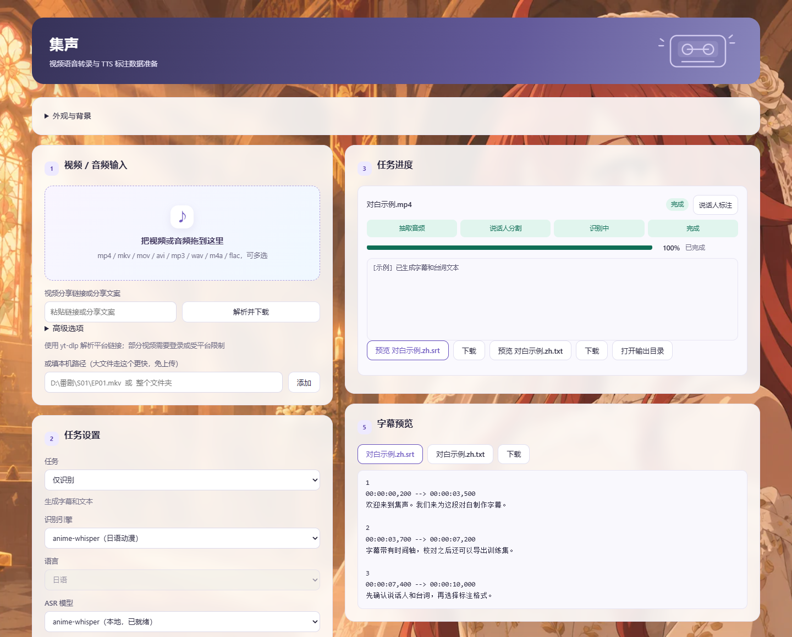
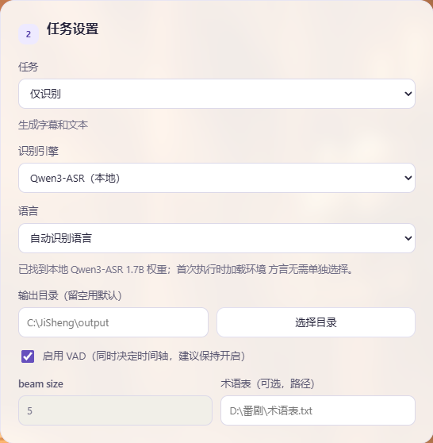
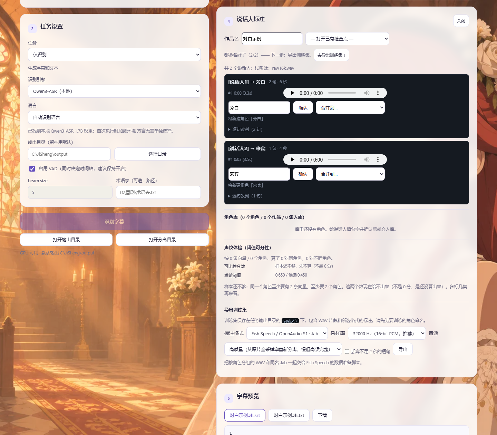

# 集声（JiSheng）

面向 Windows 的本地视频语音转录与 TTS 标注数据准备工具。

集声能从视频或音频中识别对白，生成带时间轴的 SRT 字幕和 TXT 文本。核对说话人和台词后，还可以切分对白并导出供 TTS 训练使用的 WAV 和标注文件。

[快速开始](#windows-快速开始) · [界面预览](#界面预览) · [训练集导出](#训练集导出) · [MIT 许可证](LICENSE)



## 核心功能

1. **灵活导入**。支持拖入 MP4、MKV、MOV、AVI、MP3、WAV、M4A、FLAC 等格式，可多选。也可直接填写本机文件或文件夹路径以跳过上传，或在联网时通过支持的分享链接导入。
2. **分阶段处理**。按需选择仅抽音频、仅识别、仅分离、仅分割说话人或完整流水线。支持 VAD 和指定输出目录，anime-whisper 可调整 beam size，术语表可统一识别后的专有词用字。
3. **双引擎识别**。日语可用 anime-whisper，多语言可配合本地 Qwen3-ASR。Qwen 支持自动识别语言，覆盖中文（含方言）、粤语、英语、日语、韩语、法语、德语、西班牙语、泰语等，完整列表可在工作台的「语言」里查看。
4. **说话人标注**。逐段试听，给声音分组命名并核对台词或修正归属。本地角色库可为同一作品的后续素材提供匹配建议。
5. **字幕和训练数据导出**。支持字幕预览，以及下表中的音频和标注格式。
6. **本地工作台**。按「导入素材 → 执行所选功能 → 标注与导出」组织操作。可选择内置背景或导入图片，调节透明度与毛玻璃。

| 场景 | 输出格式 | 用途 |
| --- | --- | --- |
| 字幕与文本 | `.srt` / `.txt` | 视频字幕、访谈与对白整理 |
| 通用 TTS 标注 | `.txt` + WAV | 音频、角色、语言和台词清单 |
| GPT-SoVITS | `.list` + WAV | GPT-SoVITS 数据准备 |
| Fish Speech | 同名 `.lab` + WAV | Fish Speech 数据准备 |
| IndexTTS2 | `.jsonl` + WAV | IndexTTS2 社区训练器数据准备 |

## Windows 快速开始

从仓库页面选择 **Code → Download ZIP** 并解压源码。安装 64 位 Python 3.13 和 FFmpeg。确保 `ffmpeg.exe`、`ffprobe.exe` 都在 `PATH`，或放在项目内的 `tools\ffmpeg\bin\`。如果已有 FFmpeg，可在 PowerShell 中设置 `$env:FFMPEG_DIR = 'C:\path\to\ffmpeg\bin'`，再从同一个窗口运行项目的 `.cmd` 启动器。

在项目目录打开 PowerShell，依次运行下面的命令。

```powershell
py -3.13 -m venv venv
.\venv\Scripts\python.exe -m pip install -r requirements.txt
.\jisheng.cmd --check
.\jisheng.cmd --download
.\jisheng-webui.cmd
```

`--check` 会显示实际找到的 FFmpeg 和 ffprobe 路径。两项就绪后，`--download` 会从 Hugging Face 匿名下载默认日语识别模型，约 1.4 GB。已有权重可放到 `models\anime-whisper-ct2-fp16\`。公开模型也可通过 `--endpoint` 选用可信镜像。

用 `jisheng-webui.cmd` 启动后，在浏览器打开 [本机工作台](http://127.0.0.1:8760)。请通过这个地址连接后台服务。

- **第一次做字幕**。拖入一段短日语视频，保留「仅识别」与默认引擎。点击「识别字幕」，在完成卡片里预览或下载 SRT 和 TXT。
- **第一次做 TTS 数据**。配置说话人分割后，运行包含识别和说话人分割的完整流程。试听片段并核对角色、台词及归属，再选择对应的标注格式。

也可以直接在命令行转录。

```powershell
.\jisheng.cmd "C:\path with spaces\episode.mkv" --device cpu
```

成果默认保存在项目的 `output\`，模型和检查点分别保存在 `models\` 与 `work\`。CPU 可用 `--device cpu` 明确指定。若机器上已有与 CTranslate2 兼容的 NVIDIA CUDA 运行库，可把 DLL 目录以分号分隔放入 `JISHENG_CUDA_LIB`，然后运行 `jisheng.cmd --check` 检查识别到的环境。

## 界面预览

下图中的对白和任务使用演示数据。





## 可选功能

- **说话人分割**。运行 `setup_diarize.cmd` 安装独立的 `venv-diarize`。在线模型需要 Hugging Face 授权及 `HF_TOKEN`。已有本地权重和目录布局见 [说话人分割说明](说话人分割说明.md)。
- **人声分离**。在独立的 `venv-sep` 中安装与机器匹配的 PyTorch 和 `audio-separator`。已有分离模型放在 `models\separators\`，在工作台内选择对应模型。
- **Qwen3-ASR**。工作台在 `venv-diarize` 中运行 `qwen_worker.py`。该环境需要支持 Qwen3-ASR 的 Transformers 及兼容的 PyTorch，模型放在 `models\Qwen3-ASR-1.7B-hf\`。默认 Whisper 识别无需这些依赖。
- **链接下载**。如果 `PATH` 中没有 `yt-dlp`，可运行 `.\venv\Scripts\python.exe -m pip install -r requirements-download.txt`。

项目使用独立环境来隔离各模型的依赖。可选环境的 GPU 版本与模型权重请按各自上游要求准备。

## 外观与背景

展开页面顶部的「外观与背景」，可切换惠惠、艾莉丝、可莉与旅行者三张内置背景，也可以导入本地图片。背景支持调整适配方式、位置、亮度和不透明度，毛玻璃可单独开关。本地图片和外观设置随当前浏览器保留。

## 训练集导出

给说话人命名并检查台词后，在训练集面板选择标注格式。音频统一导出为单声道 16 位 PCM WAV，采样率可选 32 kHz 或 44.1 kHz。默认保存到 `output\说话人\`。同名作品已有导出时，会写入新的子目录，便于保留不同集或格式的产物。

GPT-SoVITS 需要明确的日语、中文、英语、韩语或粤语标签。其他格式接受工作台提供的识别语言。自动识别没有保存语言结果时，以 `und` 标记未知语言。

- **GPT-SoVITS** 使用 `.list`，每行记录音频路径、角色、语种和台词。文件使用绝对音频路径，同批产物移动后需更新路径。[GPT-SoVITS 数据集格式](https://github.com/RVC-Boss/GPT-SoVITS/blob/main/docs/cn/README.md#数据集格式)
- **TXT** 是 UTF-8 制表符分隔清单，包含音频、角色、语种和台词。音频路径相对于清单目录。
- **Fish Speech / OpenAudio S1-mini** 使用按角色分组的同名 WAV 与 `.lab` 文件。将包含角色子目录的作品文件夹提供给训练工具。另附 TXT 索引供检查音频和标注配对。[Fish Speech 1.5 数据准备](https://github.com/fishaudio/fish-speech/blob/v1.5.0/docs/en/finetune.md#1-prepare-the-dataset) · [OpenAudio S1-mini 微调流程](https://github.com/fishaudio/fish-speech/blob/v2.0.0-beta/docs/en/finetune.md#1-prepare-the-dataset)
- **IndexTTS2 社区版** 使用 `instavar/indextts2-finetuning` 的清单约定。JSONL 包含 `id`、`text`、`audio`、`speaker` 和 `language`，经该项目的 `tools/preprocess_data.py --manifest` 处理，中文需指定 `--language zh` 和对应 tokenizer。这个选项用于该社区预处理流程。[社区预处理脚本](https://github.com/instavar/indextts2-finetuning/blob/main/tools/preprocess_data.py)

## 适用场景与许可

适合制作视频字幕、整理访谈或对白，以及把录音加工成 TTS 训练素材。模型就绪后可以离线识别和整理素材。下载模型和通过分享链接导入媒体需要网络，TTS 模型训练在对应的训练工具中进行。

集声源码和文档采用 [MIT 许可证](LICENSE)。另行获取的程序、依赖和模型遵循各自的许可证或使用条款。媒体、声纹库、Cookie 和模型权重由用户在本机管理。处理、导出或分享素材及衍生数据时，请确认有相应的使用权。[安全报告方式](SECURITY.md)
